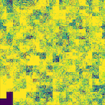

[README](README.md) | [Introduction](Introduction.md) | [Datasets](Datasets.md) | [Dpkt](Dpkt.md) | [Pyarrow](Pyarrow.md) | [Tasks](Tasks.md) | Task 7 ⮕ | [flow compare](flow_compare.ipynb) | [flow analysis](flow_analysis.ipynb)

# Task 7 Guidance: Visualizing a Scan with a Hilbert Curve

This provides a guide to visualizing the scanner's destination addresses, from Task 7, as a 2-D image that preserves address-space locality.

### Why Not Just List Destinations?

The scanner's most-targeted /16 contains 65,536 possible addresses. A table of "destination IP → packet count" is complete but hard to read as a whole — you can't easily tell whether the scanner covered the block systematically, skipped ranges, or clustered around a few subnets. Laying all 65,536 addresses out on a 2-D grid solves this, *provided* the layout keeps numerically nearby addresses visually nearby — otherwise the image is just noise.

### Why a Hilbert Curve (and Not Row-Major Order)

The obvious layout — address `256*o2 + o3` maps to raster position `(o2, o3)` — already keeps the third and fourth octets close together in one direction, but jumps a full row for every increment of the third octet, splitting a contiguous range like `x.x.5.250`–`x.x.6.10` across two visually distant rows. A **Hilbert curve** is a space-filling curve with a stronger guarantee: any two indices that are close together in the 1-D sequence map to points that are close together in 2-D, **at every scale** — a contiguous range of addresses always forms a compact, connected region in the image, not just within a single row. This is why Hilbert curves are a standard choice for visualizing IP address space (and other hierarchical numeric spaces).




### The Algorithm

A Hilbert curve of **order** `k` covers a `2^k × 2^k` grid. For an order-8 curve (256×256 — exactly enough for one /16's third and fourth octets), converting a 1-D distance `d` (0 to 65,535) to an `(x, y)` coordinate works by peeling off 2 bits of `d` at a time, from the most significant end, and using them to rotate/reflect a running `(x, y)` position:

```python
def _rot(n, x, y, rx, ry):
    if ry == 0:
        if rx == 1:
            x = n - 1 - x
            y = n - 1 - y
        x, y = y, x
    return x, y

def hilbert_d2xy(order, d):
    n = 1 << order
    x = y = 0
    t = d
    s = 1
    while s < n:
        rx = 1 & (t // 2)
        ry = 1 & (t ^ rx)
        x, y = _rot(s, x, y, rx, ry)
        x += s * rx
        y += s * ry
        t //= 4
        s *= 2
    return x, y
```

### Mapping Addresses to the Grid

For a destination IP `o0.o1.o2.o3` within the scanner's most-targeted `o0.o1.0.0/16`, the distance along the curve is `d = o2 * 256 + o3` (the address's position within the /16, treating the third and fourth octets as one 16-bit number). Feed `d` to `hilbert_d2xy(8, d)` to get its `(x, y)` position in the 256×256 image, then accumulate that destination's packet count into `grid[y][x]`.

### Worked Example

```
Destinations probed (within 172.16.0.0/16):
  172.16.0.1   -> 40 packets   (o2=0, o3=1   -> d=1)
  172.16.0.2   -> 40 packets   (o2=0, o3=2   -> d=2)
  172.16.5.200 -> 12 packets   (o2=5, o3=200 -> d=1480)

hilbert_d2xy(8, 1)    -> (x1, y1)   # adjacent to d=0's origin corner
hilbert_d2xy(8, 2)    -> (x2, y2)   # adjacent to (x1, y1) - d=1 and d=2 are close in the curve
hilbert_d2xy(8, 1480) -> (x3, y3)   # far from the above - a different region of the /16

grid[y1][x1] += 40
grid[y2][x2] += 40
grid[y3][x3] += 12
```

The two addresses that are numerically adjacent (`.0.1` and `.0.2`) land on adjacent pixels; the address 1,479 addresses away lands somewhere else in the image entirely — exactly the locality property that makes gaps and clusters in the scanner's coverage visible at a glance.

[README](README.md) | [Introduction](Introduction.md) | [Datasets](Datasets.md) | [Dpkt](Dpkt.md) | [Pyarrow](Pyarrow.md) | [Tasks](Tasks.md) | Task 7 ⮕ | [flow compare](flow_compare.ipynb) | [flow analysis](flow_analysis.ipynb)
